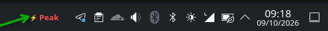

# DeepSeek Peak Status for KDE Plasma 6 & Arch Linux


A lightweight KDE Plasma 6 taskbar widget and standalone CLI Python script to monitor DeepSeek API peak vs. off-peak hours in real-time.

## Peak Schedule (UTC+1)
* **Morning Window 1:** 02:00 – 05:00 (01:00 – 04:00 UTC)
* **Morning / Midday Window 2:** 07:00 – 11:00 (06:00 – 10:00 UTC)
* **Off-Peak:** All other times, weekends, and official holidays.

## Installation

```bash
git clone https://github.com/GOG-777/deepseek-peak-status.git
cd deepseek-peak-status
./install.sh
```

Restart `plasmashell` or add **DeepSeek Status** from the Plasma widget drawer directly onto your taskbar.

